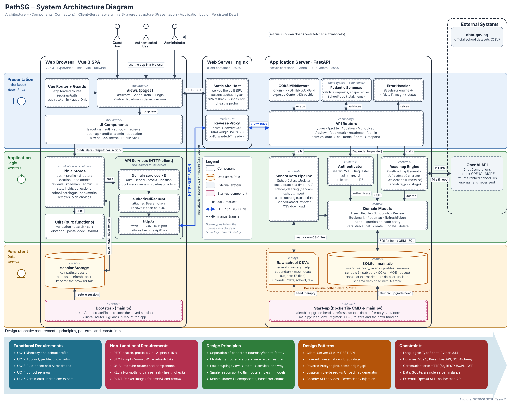

# PathSG System Architecture

## Architecture

**Style:** Client–Server (communicating processes), with a 3-layered structure inside each tier:
Presentation (`«boundary»`), Application Logic (`«control»`) and Persistent Data (`«entity»`).

### Components

| Tier | Component | Code | Role |
| ---- | --------- | ---- | ---- |
| Browser | Views, UI Components, Vue Router + Guards | `client/src/views`, `components`, `router` | Pages the three actors use; guards enforce `requiresAuth`, `requiresAdmin`, `guestOnly` |
| Browser | Pinia Stores | `client/src/stores` | Use-case logic and state, including the collections (school catalogue, bookmarks, reviews, plan choices) |
| Browser | API Services (HTTP client) | `client/src/services` | One service per feature over `authorizedRequest` (Bearer token, one renewal on 401) and `http.ts` |
| Browser | Utils | `client/src/utils` | Pure functions: validation, search, distance, formatting |
| Browser | sessionStorage | `services/sessionStorage.ts` | Access and refresh token for the life of the tab |
| Browser | Bootstrap | `client/src/main.ts` | Start-up: create app and Pinia, restore the session, install the router, mount |
| nginx | Static Site Host, Reverse Proxy | `client/nginx.conf.template` | Serves the built SPA; forwards `/api/*` to `server:8000` so the browser sees one origin |
| FastAPI | CORS, Pydantic Schemas, Error Handler | `server/main.py`, `schemas/`, `core/exceptions.py` | API boundary: origin check, validation and response shape, `HttpError` to `{"detail"}` |
| FastAPI | API Routers | `server/routers/` | Eight routers, kept thin: validate, call a model or `core/` class, respond |
| FastAPI | Authenticator | `core/authenticator.py` | Bearer JWT to `Requester`; admin guard reads the role from the database on every request |
| FastAPI | Roadmap Engine | `core/roadmap_rules.py`, `roadmap_ai.py`, `roadmap_pool.py`, `geolocation.py` | Rule-based and AI generators over a stage's candidate schools; distance from postal-district centroids |
| FastAPI | School Data Pipeline | `core/dataset_update.py`, `school_cleaning.py`, `school_import.py`, `dataset_export.py` | Admin CSV update (one at a time, all-or-nothing) and CSV export |
| FastAPI | Domain Models | `server/models/` | Entities with their own rules and queries, on a shared `Persistable` mixin |
| Data | SQLite `main.db`, raw CSV files | `/data` volume `pathsg-data` | 12 tables versioned with Alembic; uploaded CSVs kept for the next refresh |
| Start-up | Dockerfile `CMD` + `main.py` | `server/Dockerfile`, `server/main.py` | `alembic upgrade head`, `refresh_school_data --if-empty`, then `uvicorn` with one worker |
| External | OpenAI API | `core/roadmap_ai.py` | Ranks candidate schools for the AI roadmap; 14 s timeout; the username is never sent |
| External | data.gov.sg | none (manual) | Source of the school CSVs; an administrator downloads and uploads them |
| External | OneMap tiles | `client/src/data/map.ts`, `components/roadmap/PlanMap.vue` | Basemap for the roadmap maps, drawn with Leaflet; no API key. The browser asks OneMap for tiles of the area shown, never for the postal code itself |

### Connectors

| Connector | Between | Mechanism |
| --------- | ------- | --------- |
| Interaction | Actors and Views | Browser events and rendering |
| Composition, reactive binding | Views, UI Components and Stores | Vue props and Pinia reactivity; `calls` run one way, view to store to service |
| **HTTP (REST/JSON)** | API Services and nginx and FastAPI | `fetch`, JSON or multipart (CSV upload), `Authorization: Bearer <JWT>`; nginx `proxy_pass` |
| `Depends(Requester)` | Routers and Authenticator | FastAPI dependency injection |
| Method calls | Routers, engine, pipeline and models | In-process Python calls |
| SQLAlchemy ORM / SQL | Models and SQLite | Sessions and transactions |
| HTTPS | Roadmap Engine and OpenAI | OpenAI SDK, strict JSON schema answer |
| HTTPS | Roadmap map and OneMap | Leaflet requests map tiles straight from the browser; the API is not involved |
| Manual transfer | data.gov.sg and the administrator | CSV download, never automatic |

## Design Decisions

| Decision | Implementation |
| --------- | ------------------------ |
| User interfaces | Views and components for guests, authenticated users, and administrators |
| Domain model | `User`, `Role`, and student `Profile` |
| Startup | Client `main.ts`; server `main.py` and Dockerfile `CMD` |
| Coordination | Pinia stores, API routers, authentication, roadmap generators, and dataset services |
| Typed boundaries | Pydantic schemas, error enums, and TypeScript types |
| Collections | School catalogues, bookmarks, reviews, candidate pools, and roadmap choices |
| Patterns | Strategy, Facade, Dependency Injection, Observer, and Reverse Proxy |

## Architecture Rationale

- **Functional requirements:** UC-1 to UC-5 map onto one feature area each, from view to store to
  service to router to model.
- **Non-functional requirements:** a stateless web tier and a single SQLite writer keep the
  deployment small (`QUAL-3`, `QUAL-4`); atomic data refresh and 5-minute tokens cover reliability
  and security (`SEC-2` to `SEC-6`); the 14 s AI cut-off keeps the plan inside `PERF-7`.
- **Design principles:** separation of concerns, modularity, low coupling and single
  responsibility, as in `QUAL-3` and the server README ("routers stay thin").
- **Constraints:** TypeScript and Python 3.14, REST over HTTP, SQLite on one instance, and no live
  map API (distance comes from postal-district centroids).

## Implementation Notes

- `SEC-5` says JWTs in HTTP-only cookies for 24 hours. The code uses a Bearer access token (5
  minutes) and a single-use refresh token (7 days), kept in `sessionStorage`. The diagram shows the
  code; the SRS's own *Communications Interfaces* section already describes it this way.
- `SAFE-1` asks for a daily backup of the SQLite file. No backup job exists in the repository, so
  the diagram shows none.
- During development the client talks to `:8000` directly (`VITE_API_URL`), which is why the CORS
  middleware exists; in Docker everything goes through nginx on one origin.
