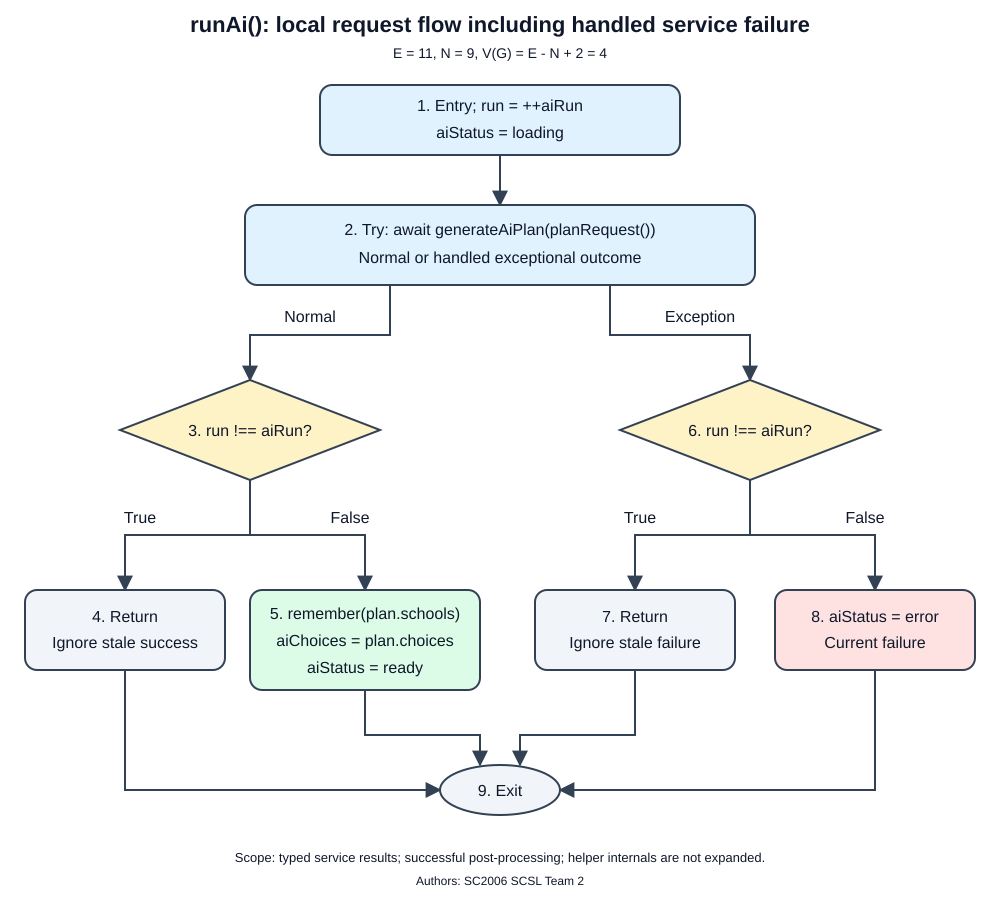
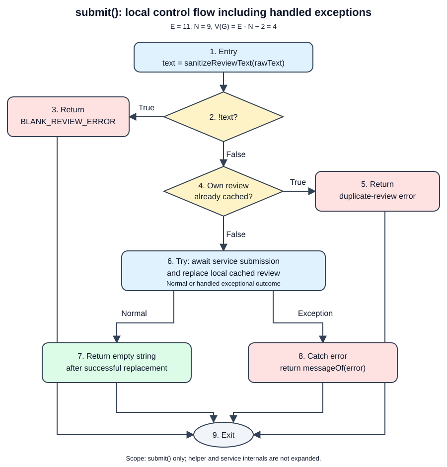

# White-Box Testing

Authors: SC2006 SCSL Team 2

We used basis path testing for `runAi()` and `submit()`. The graphs include service
failures but do not expand the code inside helper functions. Each test uses a new
Pinia instance and a fake API.

## 1. AI Roadmap Generation: `runAi()`

Location: `client/src/stores/roadmap.ts`.
Tests: `client/src/stores/__tests__/roadmap.spec.ts`.
Design class: `RoadmapController`.
Requirements: REQ-3.3 and REQ-3.7.

`runAi()` requests an AI plan and handles the response. We tested successful and
failed requests, including responses that arrive after the user changes stage.
The graph assumes responses have the expected structure and helper calls succeed.

### 1.1 Control Flow Graph

| Node | Operation |
|---|---|
| 1 | Entry; `run = ++aiRun`; `aiStatus = 'loading'` |
| 2 | Await `generateAiPlan(planRequest())`; normal or handled exceptional outcome |
| 3 | After success, is `run !== aiRun` true? |
| 4 | Return without applying a stale successful response |
| 5 | `remember(plan.schools)`; store `plan.choices`; set `aiStatus = 'ready'` |
| 6 | In catch, is `run !== aiRun` true? |
| 7 | Return without applying a stale failure |
| 8 | Set `aiStatus = 'error'` for the current request |
| 9 | Common exit |

Edges: `1-2`, `2-3`, `2-6`, `3-4`, `3-5`, `4-9`, `5-9`, `6-7`, `6-8`, `7-9`, `8-9`.

With 11 edges, 9 nodes, and one connected component:
`V(G) = E - N + 2 = 11 - 9 + 2 = 4`.

### 1.2 Independent Paths

| Path | Node sequence | Condition | Test ID |
|---|---|---|---|
| P1 | 1-2-3-5-9 | Success; request is current | WB-AI-01 |
| P2 | 1-2-3-4-9 | Success; request is stale | WB-AI-02 |
| P3 | 1-2-6-8-9 | Failure; request is current | WB-AI-03 |
| P4 | 1-2-6-7-9 | Failure; request is stale | WB-AI-04 |

Each path has a unique edge: 3-5, 3-4, 6-8, or 6-7.

### 1.3 Test Cases and Results

User: `planner2026`; initial stage: secondary; postal: `556000`; score: empty.
The AI request body is
`{ stage: 'secondary', postal: '556000', previous_academic_score: null }`.
`generate()` starts both plans. Changing stage makes earlier requests stale.

| Test ID | Path | Input and precondition | Expected output | Actual output | Result |
|---|---|---|---|---|---|
| WB-AI-01 | P1 | Call `generate()`; fake AI returns choices [7, 6, 5] and their school descriptions; wait for completion | One AI request; status ready; displayed school names are Bukit Panjang Govt. High School, Cedar Girls' Secondary School, Raffles Institution | Ready status; expected school names; one AI request | Pass |
| WB-AI-02 | P2 | Hold the AI route; call `generate()`; select stage uni; release a successful old request | One AI request with the original secondary-stage body; selected stage stays uni; AI status remains idle and plan empty | Uni stage, idle status, empty plan; one original secondary request | Pass |
| WB-AI-03 | P3 | Set fake AI outcome to error; call `generate()`; fake service returns HTTP 503; wait for completion | One AI request; AI status error and plan empty; rule status ready with three nodes; generated state true | AI error and empty plan; rule ready with three nodes; generated true; one AI request | Pass |
| WB-AI-04 | P4 | Hold the AI route; call `generate()`; select stage uni; set fake AI outcome to error; release the old request | One AI request with the original secondary-stage body; selected stage stays uni; AI status remains idle and plan empty | Uni stage, idle status, empty plan; one original secondary request | Pass |

The test file passed **36 tests**, including these four basis cases.

## 2. Review Submission: `submit()`

Location: `client/src/stores/reviews.ts`.
Tests: `client/src/stores/__tests__/reviews.spec.ts`.
Design responsibility: `ReviewController`.
Requirements: REQ-4.1, REQ-4.6, REQ-4.10, and BR-6.

We varied the review text, existing reviews, and service response for the chosen
school and account.

### 2.1 Control Flow Graph

| Node | Operation |
|---|---|
| 1 | Entry; `text = sanitizeReviewText(rawText)` |
| 2 | Is `!text` true? |
| 3 | Return `BLANK_REVIEW_ERROR` |
| 4 | Does `ownReview(schoolId, username)` find a review? |
| 5 | Return `You have already reviewed this school.` |
| 6 | Execute `replace(await reviewService.submitReview(schoolId, text))`; normal or handled exceptional outcome |
| 7 | Return the empty string after successful replacement |
| 8 | Catch the error and return `messageOf(error)` |
| 9 | Common exit |

Edges: `1-2`, `2-3`, `2-4`, `3-9`, `4-5`, `4-6`, `5-9`, `6-7`, `6-8`, `7-9`, `8-9`.

With 11 edges, 9 nodes, and one connected component:
`V(G) = E - N + 2 = 11 - 9 + 2 = 4`.

### 2.2 Independent Paths

| Path | Node sequence | Distinct branch covered |
|---|---|---|
| P1 | 1-2-3-9 | Blank text rejected before any request |
| P2 | 1-2-4-5-9 | Locally known duplicate rejected before any request |
| P3 | 1-2-4-6-7-9 | Service succeeds and local review cache is updated |
| P4 | 1-2-4-6-8-9 | Service fails and the error is returned |

Each path has a unique edge: 2-3, 4-5, 6-7, or 6-8.

### 2.3 Test Cases and Results

Each case starts independently with authenticated user `planner2026`.

| Test ID | Path | Input and precondition | Expected output | Actual output | Result |
|---|---|---|---|---|---|
| WB-REV-01 | P1 | `submit(1, 'planner2026', '')`; no own review cached | `Review text cannot be blank or consist entirely of spaces.`; no POST request | Returned the exact blank-review message; POST count was 0 for each parameterised input | Pass |
| WB-REV-02 | P2 | Successfully submit `First` to school 1 as setup; then `submit(1, 'planner2026', 'Second')` | `You have already reviewed this school.`; no second POST; one cached review | Returned the duplicate-review message; POST count stayed at 1 after setup; cache contained one review | Pass |
| WB-REV-03 | P3 | Load school 2, which has other users' reviews; `submit(2, 'planner2026', 'Great school')` | Empty string; one POST; new review is newest in the local cache and is present in fake-server state | Returned `''`; POST count was 1; newest cached review matched the account and text; fake server contained the new review | Pass |
| WB-REV-04 | P4 | Fake server has an own review at school 1, but the local cache has not loaded it; `submit(1, 'planner2026', 'Second')` | `You have already reviewed this school.` from the server refusal; one POST; local cache remains empty; server still has one school-1 review | Returned the server's duplicate-review message; POST count was 1; local cache stayed empty; fake server retained one school-1 review | Pass |

Both duplicate-review paths return the same message. The request count shows whether
the store rejected the review locally or the server refused it. WB-REV-01 uses an empty
string; additional tests cover whitespace and empty HTML. A network-error test checks
that existing reviews are kept when submission fails.

The test file passed **21 tests**, including these four basis cases.

## 3. Execution and Scope

Executed on 2026-10-29: all eight basis-case IDs passed in the full frontend run
of **68 files / 890 tests**. Test IDs appear in the executable test titles.

Run from `client`: `npm test -- roadmap.spec.ts reviews.spec.ts`.

These tests cover the frontend methods. Backend sanitisation (REQ-4.4), live AI
responses, database failures, and UI messages need separate integration tests.
